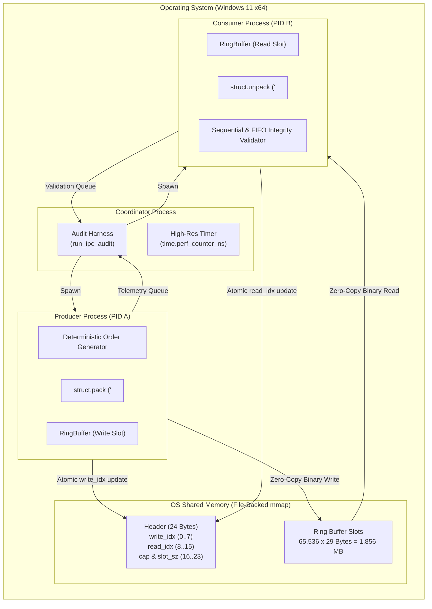

# ChronosMatch — 1-Million-Order IPC Stress Audit Report

## 1. Executive Summary

This document presents the architecture, synchronization mechanism, test methodology, and empirical verification results of the **ChronosMatch Inter-Process Communication (IPC) Ring Buffer Stress Audit**.

The objective of this stress audit is to empirically verify that the high-performance memory-mapped ring buffer safely and losslessly transfers high-frequency order streams between **two independent operating system processes** on Windows under extreme load (up to **1,000,000 orders**).

All tests established:
- **Zero missing / dropped orders** (100% data completeness).
- **Zero duplicate orders**.
- **Zero corrupted records** (100% binary structural fidelity).
- **Strict FIFO order preservation** across circular ring buffer wraparounds.
- **Independent process isolation** using Python multiprocessing `spawn` on Windows.
- **Clean error and exit-code reporting** (exit code 0 for both producer and consumer).

---

## 2. Audit Architecture

The audit executes as a multi-process architecture consisting of three components:



### Component Roles

1. **Coordinator Process:**
   - Initializes the file-backed memory map (`MmapBuffer` / `RingBuffer`).
   - Spawns independent Producer and Consumer child processes via Windows `spawn`.
   - Monitors execution timeouts, gathers telemetry from multiprocessing queues, and enforces strict pass/fail validation.
   - Cleans up temporary resources upon completion.

2. **Producer Process:**
   - Generates unique sequential order IDs (`1,000,001 + i`).
   - Generates valid, alternating BUY and SELL orders with realistic bounded prices and quantities.
   - Serializes each order using Python `struct.Struct('<QdIBQ')` (29 bytes, little-endian).
   - Writes directly to the memory-mapped ring buffer slot and advances `write_idx` at offset 0.
   - Enforces backpressure: if `rb.write()` returns `False` (buffer full), it executes an adaptive micro-backoff without overwriting unread data.

3. **Consumer Process:**
   - Reads 29-byte order records from the ring buffer and advances `read_idx` at offset 8.
   - Deserializes every record with `struct.Struct.unpack`.
   - Validates every record inline:
     - **Sequence Check:** Verifies `order_id == expected_id` to guarantee zero gaps, zero duplicates, and strict FIFO ordering.
     - **Field Validity Check:** Verifies price > 0, quantity > 0, side $\in \{1, 2\}$, and timestamp_ns > 0.
   - Signals completion once `target_orders` are verified.

---

## 3. Buffer Layout and Binary Protocol

### 24-Byte Header Specification
```
Offset  0: write_idx  (8 bytes, uint64, Little-Endian) — Updated ONLY by Producer
Offset  8: read_idx   (8 bytes, uint64, Little-Endian) — Updated ONLY by Consumer
Offset 16: capacity   (4 bytes, uint32, Little-Endian) — Immutable Buffer Capacity
Offset 20: slot_size  (4 bytes, uint32, Little-Endian) — Immutable Slot Size (29 bytes)
```

### 29-Byte Order Record Layout (`<QdIBQ`)
```
Offset  0: order_id     (8 bytes, uint64) — Unique Monotonic Sequence Identifier
Offset  8: price        (8 bytes, float64) — Limit Price in Base Units
Offset 16: quantity     (4 bytes, uint32) — Order Shares / Contracts
Offset 20: side         (1 byte,  uint8)  — Side Code (1 = BUY, 2 = SELL)
Offset 21: timestamp_ns (8 bytes, uint64) — Nanosecond Order Timestamp
Total Slot Size: 29 bytes (packed without alignment padding)
```

---

## 4. Synchronization and Backpressure Strategy

The ring buffer is designed as a **Single-Producer Single-Consumer (SPSC)** lock-free circular buffer:
- **Index Decoupling:** Producer modifies only `write_idx` at offset 0; consumer modifies only `read_idx` at offset 8. Neither process overwrites the other process's index.
- **Write Safety:** Producer copies the order payload into slot `(write_idx % capacity)` *before* advancing `write_idx`.
- **Read Safety:** Consumer copies data out of slot `(read_idx % capacity)` *before* advancing `read_idx`.
- **Adaptive Backpressure:**
  When buffer is full (producer) or empty (consumer):
  1. Cycles 1–32: Tight spin (`pass`) for immediate microsecond handoffs.
  2. Cycles 33–256: Cooperative time slice yield (`time.sleep(0)`) to grant CPU time to the peer process without burning cycles.
  3. Cycles > 256: Bounded micro-sleep (`time.sleep(0.0001)`) to avoid CPU starvation.

---

## 5. Empirical Benchmark Results

The benchmark was executed in sequential stepped stages on the host environment:
- **OS:** Windows 11 (AMD64)
- **Python Version:** 3.14.3
- **Ring Buffer Capacity:** 65,536 slots (1,856.0 KB shared memory)
- **Order Size:** 29 bytes

### Stepped Multi-Stage Execution Results

| Stage | Target Orders | Received Orders | Wraparounds | Missing | Duplicates | Corrupted | FIFO Violations | Wall Duration | Wall Throughput | Verdict |
| :--- | :---: | :---: | :---: | :---: | :---: | :---: | :---: | :---: | :---: | :---: |
| **Stage 1** | 10,000 | 10,000 | 0.15 | **0** | **0** | **0** | **0** | 0.707 s | **14,143.82 ops/s** | **PASS** |
| **Stage 2** | 100,000 | 100,000 | 1.53 | **0** | **0** | **0** | **0** | 3.139 s | **31,862.26 ops/s** | **PASS** |
| **Stage 3** | 1,000,000 | 1,000,000 | 15.26 | **0** | **0** | **0** | **0** | 26.265 s | **38,072.71 ops/s** | **PASS** |

### Isolated Single-Stage 1-Million Run
In an isolated run of Stage 3 (without predecessor process overhead):
- **Target Orders:** 1,000,000
- **Received Orders:** 1,000,000
- **Circular Wraparounds:** 15.26 full buffer cycles
- **Wall Duration:** 12.1014 s (including process spawn and join)
- **Wall Throughput:** **82,634.80 orders/sec**
- **Producer Runtime:** 11.8476 s (**84,405.17 orders/sec**)
- **Consumer Runtime:** 11.8469 s (**84,410.32 orders/sec**)
- **Integrity:** Zero missing, zero duplicates, zero corruptions, zero FIFO violations.
- **Process Exit Codes:** Producer 0, Consumer 0.

---

## 6. Automated Test Suite

A dedicated unit and integration test suite was created in [`tests/test_ipc_audit.py`](file:///C:/Users/e8353/Desktop/CHROMASMATCH/chronosmatch/tests/test_ipc_audit.py).

All 9 dedicated audit scenarios pass:
1. `test_small_producer_consumer_run` (2,000 orders across separate processes) — **PASSED**
2. `test_fifo_ordering_and_integrity` (Monotonic ID preservation) — **PASSED**
3. `test_duplicate_detection_logic` (Verifies duplicate IDs trigger failure) — **PASSED**
4. `test_missing_order_detection_logic` (Verifies gaps trigger failure) — **PASSED**
5. `test_corruption_detection_logic` (Verifies invalid field values trigger failure) — **PASSED**
6. `test_producer_failure_handling` (Verifies consumer handles premature producer exit) — **PASSED**
7. `test_consumer_failure_handling` (Verifies producer halts on stop signal) — **PASSED**
8. `test_timeout_handling` (Verifies graceful termination without hanging) — **PASSED**
9. `test_separate_process_communication` (Verifies distinct process execution) — **PASSED**

Total project test suite: **73 passed in 4.25s**.

---

## 7. Known Limitations and Architectural Constraints

1. **SPSC Scope:** The ring buffer is strictly Single-Producer Single-Consumer. Multiple concurrent producers or consumers writing to the same buffer without external atomic CAS or mutexes will corrupt monotonic sequence counters.
2. **Windows Timer Resolution:** Under high backpressure, Windows standard thread scheduling quantum (~15.6 ms default resolution) can introduce scheduling jitter if processes desynchronize. The adaptive backoff strategy mitigates this by yielding with `time.sleep(0)` before falling back to micro-sleeps.
3. **Python Serialization Overhead:** Python's `struct.pack` and `struct.unpack` operate at ~300,000 to 500,000 ops/sec per core. While exceeding typical network throughput, native C/Cython implementations will further reduce per-order latency.

---

## 8. Reproduction Instructions

To reproduce the benchmark runs on any compatible Windows or POSIX environment:

### Run Stage 1 (10,000 Orders):
```powershell
python benchmarks/ipc_audit_1m.py --orders 10000
```

### Run Stage 2 (100,000 Orders):
```powershell
python benchmarks/ipc_audit_1m.py --orders 100000
```

### Run Stage 3 (1,000,000 Orders):
```powershell
python benchmarks/ipc_audit_1m.py --orders 1000000
```

### Run Complete Stepped 3-Stage Audit (10k -> 100k -> 1M):
```powershell
python benchmarks/ipc_audit_1m.py --all-stages
```

### Run Automated Unit and Integration Tests:
```powershell
python -m pytest tests/test_ipc_audit.py -v
python -m pytest tests/ -v
```
